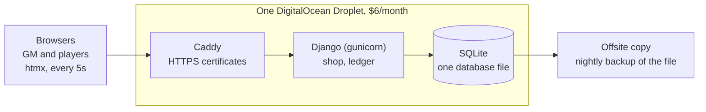

# D&D Money Tracker: Shopping List and Infrastructure Plan

Plan written 2026-11-09. Prices were checked that day from third-party summaries of DigitalOcean's pricing; confirm them on the signup page.

Scope has since grown to six Django apps (see [Django apps](#django-apps)), clubs, printing, and a donate button. The cost and infrastructure sections below were written for the smaller scope and have not been re-checked. User stories are in [docs/USER_STORIES.md](docs/USER_STORIES.md).

## Summary

Run the app on one $6/month DigitalOcean Droplet with Django and SQLite; with backups the bill is about $7.20/month, and nothing in this plan scales on its own.

The app lets game masters (GMs) assign money to player characters, and lets players spend it on shop items between sessions. The game master changes the shop's items and prices between sessions. When a limited-quantity item sells out, it disappears for every other player within a few seconds.

## What to buy

Buy one Basic Droplet with 1 GiB of RAM at $6/month, add backups if you want them, and optionally a domain name.

| Item | Cost | Needed? | Notes |
| --- | --- | --- | --- |
| DigitalOcean Droplet, Basic, 1 GiB RAM | $6/month | Yes | 1 vCPU, 25 GB SSD, about 1 TB of outbound transfer included ([plan list](https://www.temperstack.com/plans/digitalocean/)) |
| Automatic Droplet backups | about $1.20/month (20% of the Droplet price) | Optional | Weekly backups ([cost example](https://www.activepieces.com/blog/digitalocean-pricing-plans-and-real-costs-in-2026)) |
| Domain name | about $10-15/year | Optional | Approximate, not looked up; lets Caddy get a free HTTPS certificate automatically |
| Django, SQLite, htmx, gunicorn, Caddy | $0 | Yes | All free, open-source software |

Total: $6/month for the server alone, or $7.20/month with backups, plus the domain if you buy one.

Do not buy a managed database (about $15/month), a load balancer (from $12/month), or Spaces object storage (from $5/month); SQLite on the Droplet replaces all three ([add-on prices](https://diyai.io/ai-tools/hosting/digitalocean-pricing/)).

## Tentative architecture

The app is a plain Django site: game masters manage money and the shop in the Django admin, players use a small htmx shop page, and everything is stored in one SQLite file.

Browsers talk only to Caddy; the one outbound copy is the nightly backup.

Data model:

- Character: owner, name, campaign
- Item: name, price in copper, quantity (empty means unlimited), available flag
- Transaction: character, signed amount in copper, reason, timestamp; a character's balance is the sum of their transactions

When two players click Buy on the last item together, the second one gets an "already sold" message. A purchase is one database transaction: check stock and balance, subtract one, write a ledger row. The shop list is a fragment the page re-requests every 5 seconds with htmx, skipped while the browser tab is hidden.

## Django apps

Planned split. Names are tentative; a Django app name must be a valid Python name, so `player-characters` becomes `player_characters`.

| App | What it holds |
| --- | --- |
| `accounts` | User accounts, the email whitelist, and who holds which permission in which club |
| `player_characters` | The characters players play as (a player can have several): notes, stats, coins, and owned items |
| `shops` | Named shops and shopkeepers, their rotating and fixed inventories (a stock amount of each item), and the spending of player coins |
| `map` | Basic hex maps with no art (a club can have several), drawn with plain colors and symbols; which players have visited which tiles; and encounters and locations on those tiles |
| `lore` | The world and its details, migrated from the [dnd-world-keeper](https://github.com/bernvaughn/dnd-world-keeper) repo |
| `quests` | Small side quests, such as gathering items during a session and trading them in for a reward or more money |

All data belongs to a club (a group of people and their game data), and one club never sees another's. Stories exist so far for accounts, player characters, and shops; map, lore, and quests are still to be written. A site admin runs the whole site; inside a club, admin and game master are separate permissions that one account can hold together. Items live in one shared catalogue (names, descriptions, prices), and each shop holds a stock amount of each item; which app owns the catalogue is still open. Coins are stored as copper and shown split into denominations.

The data model above is a first sketch and is being reworked around these apps.

## Cost control

The monthly bill stays at the Droplet price plus backups unless you add resources or send more than the included outbound transfer. This is a pricing structure, not a hard stop: your card stays on file, so a billing alert is the safety net.

- Droplets are billed per second but never above the monthly price ([DigitalOcean pricing summary](https://www.usagepricing.com/blueprint/digitalocean)).
- The only usage-based charge on a plain Droplet is outbound transfer beyond the allowance, at $0.01 per GiB; inbound transfer is free, and 1,000 GiB of overage would cost $10 ([DigitalOcean community](https://www.digitalocean.com/community/questions/how-is-an-account-billed-if-it-goes-over-its-monthly-bandwidth-limit)). A text-only app for a game table should stay far below the roughly 1 TB included.
- Things that would add cost: extra Droplets, snapshots ($0.06 per GB per month), block storage volumes (from $10/month), and managed databases ([add-on prices](https://diyai.io/ai-tools/hosting/digitalocean-pricing/)).
- Safeguards: run exactly one Droplet, delete any snapshots you create, set an email billing alert in DigitalOcean's billing settings (confirm the exact option there), and glance at the invoice monthly.

## Risks and mitigations

The realistic risk is a lockout or a lost server, not a surprise bill, and an offsite copy of the database covers both.

| Risk | What happens | Mitigation |
| --- | --- | --- |
| Account lockout | DigitalOcean's automated checks sometimes lock accounts; one customer's services were shut down for about 24 hours in April 2026 ([community post](https://www.digitalocean.com/community/questions/two-unexplained-account-suspensions-missing-tickets-downgraded-support-plan-and-zero-accountability-digitalocean-we-need-to-talk)), and DigitalOcean has acknowledged an anti-fraud false positive ([incident update](https://www.plushcap.com/content/digitalocean/blog/an-update-on-last-weeks-customer-shutdown-incident)) | Complete any verification right away, pay invoices on time, and open a support ticket the moment a lock appears |
| Data loss | The whole app lives in one SQLite file on one disk | Copy the file every night to somewhere outside DigitalOcean, such as your own computer or a free cloud storage account; keep the weekly Droplet backup too |
| Downtime | One server means updates and reboots are yours to handle | Players spend money between sessions, so short outages are tolerable; tell the group where to ask if the site is down |

## Setup checklist and open questions

- [ ] Create a DigitalOcean account, finish any verification, and add a payment method
- [ ] Set an email billing alert
- [ ] Create one Basic Droplet (1 GiB RAM) in the region nearest your players, and turn on backups if you want them
- [ ] Optional: buy a domain and point it at the Droplet
- [ ] Install Python, Caddy and the app; run Django under gunicorn behind Caddy
- [ ] Set up the nightly offsite copy of the SQLite file and test restoring it once
- [ ] Create game master and player groups in Django and add the first campaign's characters

Open questions:

- How many players and campaigns will use the app? More than a table or two of players may call for a second look at sizing.
- Do you want a domain, or is the server's IP address fine for the group?
- Should items have a quantity limit by default, or only when the game master sets one?
