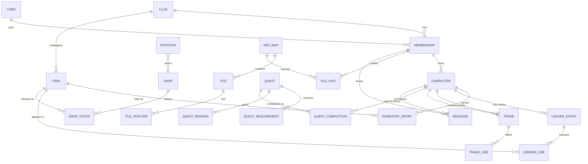

# Data model outline (draft)

A plain-language outline of the records each app keeps and how they connect, built from `docs/USER_STORIES.md`. Names are tentative. No code is implied.

## How the pieces connect

Reading it: a person (user) joins clubs through memberships, and a membership owns characters. Everything else hangs off a club, a character, or the item catalogue.

## Rules that apply everywhere

- **Every record belongs to a club.** Every lookup is limited to the current club, which is what keeps clubs from seeing each other's data (U12).
- **Coins are whole numbers of copper.** They are shown as copper, silver, gold, and platinum.
- **The ledger is the history and the source of truth.** A character's inventory and coin total are the sum of their ledger lines. The app may keep running totals for speed, but the ledger wins if they disagree. Ledger entries are never edited or deleted; a mistake is fixed with a new entry.
- **Holds are not a separate record.** Items and coins that appear on a trade or trade request that is still open count as held. What a character can use is what they own minus what is held, which is how the lock on selling, transferring, turning in, and consuming works (U16).
- **Dates on manual changes default to today** and can be changed (U14).

## By app

### accounts

- **User**: a login (email, password, display name). One person has one user, even with characters in several clubs. The site admin is a flag on the user.
- **Club**: a name. The unit that separates data.
- **Membership**: a user in a club, with two separate yes/no permissions, club admin and game master. Everyone with a membership is also a player and can own characters.
- **Whitelist entry**: an email address allowed to join a club (U1). Belongs to one club; the same email can be whitelisted in several.
- **Message**: from a membership to the club's admins, free text, with an optional character it is about (U13).

A player's email is shown only to club admins (U17).

### items

- **Item**: belongs to a club. Name, description, traits and other details, and a value in copper (I1). Items already held or in the ledger are retired rather than deleted.

### player_characters

- **Character**: belongs to a club and is owned by a membership. Name plus notes, stats, and other details the player keeps (U2). Handing a character to another player changes the owner (U18).
- **Inventory entry**: a character, an item, and a quantity. Visible only to the owner, game masters, and club admins (U19).
- **Trade**: a sending character, a receiving character, a status (requested, accepted, completed, declined, cancelled), the sender's note, and one approval for each side (U16).
- **Trade line**: one side of a trade offering either an item and quantity, or an amount of coins.

### ledger

- **Ledger entry**: a character, a date, a note ("traded to a character", "awarded by a game master"), and who made it (a person or the system). Records what kind of event it was: award, purchase, sale, trade, transfer, quest turn-in, quest reward, consumed, or manual adjustment.
- **Ledger line**: part of an entry. Either an item with a signed quantity, or a signed amount of coins. A purchase is one entry with a coin line and an item line.

### shops

- **Shop**: belongs to a club. Name, description, shopkeeper's name and description, a default sell percentage, and a default buy percentage (S1).
- **Shop stock**: a shop, an item, a quantity in stock (empty means unlimited), and optional sell and buy percentage overrides for that item in that shop (U9, S1). Stock lives here and carries over between rotations.
- **Rotation**: a name, an open date, and a close date (S2). Links to the shops that are open in it; a shop can be in several rotations.

There is no separate purchase record. A purchase or sale changes the stock and writes a ledger entry that points at the shop.

### quests

- **Quest**: belongs to a club. Name, description, start date, end date, a limit on total completions in the club, and a limit on completions per character (Q1-Q3). Empty limits mean no limit.
- **Quest requirement**: an item and a quantity a player must turn in.
- **Quest reward**: an item and quantity, or an amount of coins. A quest can have several.
- **Quest completion**: a quest, a character, and a date. The limits are counted from these. Completing one writes ledger entries for the turn-in and the reward.

### map

- **Hex map**: belongs to a club. A name; a club can have several (M1).
- **Tile**: a map and a position, with a color. Only tiles that have something on them are stored.
- **Tile feature**: a tile, a symbol, a name, and a note, for an encounter or location (M2). A tile can have several.
- **Tile visit**: a map, a position, and a membership that has been there (M3). It stores the position rather than the tile so empty tiles can be visited too. Players see only tiles they have visited; game masters see everything (M4).

## What the stories do not settle yet

Questions that came up while outlining. Each one changes what gets stored.

1. **Characters before sign-up.** U1 assigns characters to a whitelisted email before that person has an account. Do we create the membership as soon as the email is whitelisted (so characters can be assigned to it), and fill in the user when they first sign in?
2. **Shops buying things they do not sell.** Can a shop buy an item that is not in its stock list, and if so at what percentage? Do items a shop buys become part of its stock?
3. **Always-open shops.** U5 wants shops with a fixed inventory that are always available. Is that a shop marked "always open", or a rotation with no close date?
4. **Partial quest turn-ins.** Can a player turn in part of a quest's items now and the rest in a later session, or must everything be handed in at once?
5. **Used up or kept.** You said turned-in items can be used up. Is each requirement either "used up" or "shown and kept", or are turned-in items always used up?
6. **One-of-a-kind items.** Inventory is a quantity of catalogue items. Do any items need to be tracked individually, such as a magic sword with its own notes or charges?
7. **Message replies.** Can club admins reply inside the app, or only act on the message? Does a message get marked as handled?
8. **Map visits.** Visits are recorded per player. If a player has two characters, do both share the same visited tiles? Does a map have a fixed size, or can it grow in any direction?
