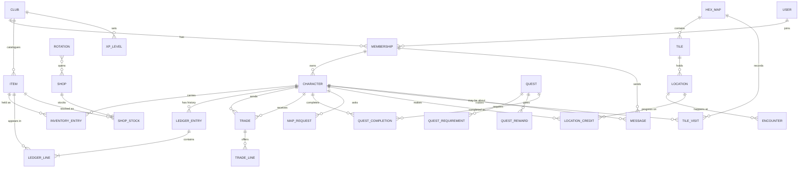

# Data model outline (draft)

A plain-language outline of the records each app keeps and how they connect, built from `docs/USER_STORIES.md`. Names are tentative. No code is implied.

## How the pieces connect

Reading it: a person (user) joins clubs through memberships, and a membership owns characters. Everything else hangs off a club, a character, or the item catalogue.

## Rules that apply everywhere

- **Every record belongs to a club.** Every lookup is limited to the current club, which is what keeps clubs from seeing each other's data (U12).
- **Coins are whole numbers of copper.** They are shown as copper, silver, gold, and platinum.
- **The ledger is the history and the source of truth.** A character's inventory and coin total are the sum of their ledger lines. The app may keep running totals for speed, but the ledger wins if they disagree. Ledger entries are never edited or deleted; a mistake is fixed with a new entry.
- **Holds are not a separate record.** Items and coins that appear on a trade or trade request that is still open count as held. What a character can use is what they own minus what is held, which is how the lock on selling, transferring, turning in, and consuming works (U16).
- **Dates on manual changes default to today** and can be changed (U14).

## By app

### accounts

- **User**: a login (email, password, display name, and a flag that the person must choose a new password at next sign-in). Accounts are created by club admins (U20) and passwords reset by them when they administer every club the person belongs to (U21); the app sends no email. One person has one user, even with characters in several clubs. The site admin is a flag on the user.
- **Club**: a name. The unit that separates data.
- **Membership**: a user in a club, with two separate yes/no permissions, club admin and game master. Everyone with a membership is also a player and can own characters.
- **Whitelist entry**: an email address allowed to join a club (U1). Belongs to one club; the same email can be whitelisted in several.
- **Message**: from a membership to the club's admins, free text, with an optional character it is about, and a handled/closed flag set by an admin (U13). No replies are stored.

A player's email is shown only to club admins (U17).

### items

- **Item**: belongs to a club. Name, description, traits and other details, and a value in copper (I1). Items already held or in the ledger are retired rather than deleted. A "unique" item is just an item a shop stocks one of or a game master gives out once; nothing is tracked individually.

### player_characters

- **Character**: belongs to a club and is owned by a membership. Name plus notes, stats, and other details the player keeps (U2). Handing a character to another player changes the owner (U18).
- **Inventory entry**: a character, an item, and a quantity. Visible only to the owner, game masters, and club admins (U19).
- **Trade**: a sending character, a receiving character, a status (requested, accepted, completed, declined, cancelled), the sender's note, and one approval for each side (U16).
- **Trade line**: one side of a trade offering either an item and quantity, or an amount of coins.

### ledger

- **Ledger entry**: a character, a date, a note ("traded to a character", "awarded by a game master"), and who made it (a person or the system). Records what kind of event it was: award, purchase, sale, trade, transfer, quest turn-in, quest reward, consumed, or manual adjustment.
- **Ledger line**: part of an entry. Either an item with a signed quantity, or a signed amount of coins. A purchase is one entry with a coin line and an item line.

### shops

- **Shop**: belongs to a club. Name, description, shopkeeper's name and description, a default sell percentage, and a default buy percentage (S1).
- **Shop stock**: a shop, an item, a quantity in stock (empty means unlimited), and optional sell and buy percentage overrides for that item in that shop (U9, S1). Stock lives here and carries over between rotations. Only items with a stock row are purchasable. A shop can still buy items it has no stock row for, using its default buy percentage, and that does not create a stock row.
- **Rotation**: a name, an open date, and an optional close date (S2). An empty close date means always open, which is how always-open shops (U5) work. Links to the shops that are open in it; a shop can be in several rotations.

There is no separate purchase record. A purchase or sale changes the stock and writes a ledger entry that points at the shop.

### quests

- **Quest**: belongs to a club. Name, description, start date, end date, a limit on total completions in the club, and a limit on completions per character (Q1-Q3). Empty limits mean no limit.
- **Quest requirement**: an item and a quantity a player must turn in. All requirements must be met in one turn-in, and the items are always used up.
- **Quest reward**: an item and quantity, or an amount of coins. A quest can have several.
- **Quest completion**: a quest, a character, and a date. The limits are counted from these. Completing one writes ledger entries for the turn-in and the reward.

### map

- **Hex map**: belongs to a club. A name, an archived flag, and no size limit (M1, M2). Safe town sits at position 0,0.
- **Tile**: a map, a position, and an optional color. Only tiles that have a location or encounter are stored; every other position is drawn blank. A tile's location count is counted from its locations (M3).
- **Location**: a tile, a name, a color, a symbol, player notes, GM notes, and a target level (M3-M5, M11). A tile can have several.
- **XP level**: per club, one row per target level band (CR 1-2 to CR 19-20) with the XP for discovering and for exploring. Filled from the default table and editable by a club admin (M13).
- **Encounter**: a location, a date, and a description of what happened (M6). Can be added during play or later.
- **Location credit**: a location, a kind (discovered or explored), a date, and a list of characters. A location has at most one of each kind. Discovery credit goes to the first group, explored credit to one group that may be different. Later characters are never added automatically; a game master or club admin can add or remove characters to correct it (M14). Credited characters also get a visit to the tile. The map marks unexplored locations on visited tiles and shows credited characters to everyone who can see the location (M15). A party is not stored: it is just the list of characters chosen when something is recorded.
- **Request**: a character (or several), what is asked for (tile visit, location discovered, or location explored), a status (requested, approved, declined), and a date. Approving creates the visit or adds the characters to the location's credited group. Nothing is declined automatically (M12).
- **Tile visit**: a map, a position, and a character that has been there (M7). It stores the position rather than the tile so empty tiles can be visited too.
- **What each person sees.** Game masters and club admins see everything, including GM notes, and can print either the full map or a players' view for a group of characters they pick (M10). A player sees the tiles visited by the characters they pick, with those tiles' locations, player notes, and encounters, but never GM notes (M8, M9).

## Settled since the first draft

1. Memberships are created when an email is whitelisted, so characters can be assigned before first sign-in.
2. Shops can buy items they do not sell, but only items they stock are purchasable.
3. Always-open shops are in a rotation with no close date.
4. Quests have no partial turn-ins.
5. Turned-in quest items are always used up.
6. No individually tracked items; a unique item is a catalogue item with a quantity of 1.
7. Messages are only marked handled or closed.
8. Map visits are per character.
9. The game master's players-only map is for a group of characters they pick.
10. Each location has one credited discovery group (the first) and one credited explored group (may differ); a game master or club admin can correct either, and everyone sees the credited characters. A party is just a list of characters, not a stored record.
11. Players can request visits, discovered, or explored credit, and a game master or club admin grants them.

## Still open

Nothing right now.
