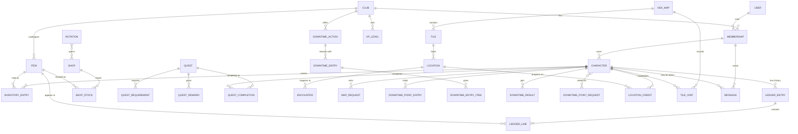

# Data model outline (draft)

A plain-language outline of the records each app keeps and how they connect, built from `docs/USER_STORIES.md`. Names are tentative. No code is implied.

## How the pieces connect

Reading it: a person (user) joins clubs through memberships, and a membership owns characters. Everything else hangs off a club, a character, or the item catalogue.

## Rules that apply everywhere

- **Every record belongs to a club.** Every lookup is limited to the current club, which is what keeps clubs from seeing each other's data (U12).
- **Coins are whole numbers of copper.** They are shown as copper, silver, gold, and platinum, with no platinum under 10,000 gp (U32).
- **The ledger is the history and the source of truth.** A character's inventory and coin total are the sum of their ledger lines. The app may keep running totals for speed, but the ledger wins if they disagree. Ledger entries are never edited or deleted; a mistake is fixed with a new entry.
- **Holds are not a separate record.** The code returns held_coins=0 and held_items={}, so nothing is held; everything owned is available. The lock on selling, transferring, turning in, and consuming still applies (U16).
- **Dates on manual changes default to today** and can be changed (U14).

## What a new club is seeded with

The site admin "new club" form creates a club and seeds it in one transaction.

### Seeded

| Area | Details |
| --- | --- |
| XP table | Default bands from `map/xp.py` (`copy_default_xp_table`). |
| Character options | Default species (11), classes (12), backgrounds (16) from `character_options/defaults.py`, seeded by `seed_default_options` in `character_options/services.py`. |
| Club admin | First admin from the form. The app sets a temporary password and `must_change_password`. |
| Items | Default item catalogue (about 100 items) from the starting-equipment data. |
| Starting equipment | Active template named "2024 D&D Default". Holds class entries, background entries, and level coins. Each "X or Y" option of the 2024 PHB is a choice group (see below). |
| Starting packs | The seven standard packs (Explorer's, Priest's, Dungeoneer's, Burglar's, Scholar's, Diplomat's, Entertainer's) are containers with their PHB contents as fixed slots. A character can open them. |

### Not seeded

Characters, shops, quests, hex maps and locations, downtime actions, ledger entries, messages, demo users. The GM creates these.

### Rules

- Seeding runs in the club-creation transaction. A failure rolls back the whole club.
- Every seeder is idempotent. It never overwrites edited rows.
- Existing clubs are not backfilled. They can run `uv run python manage.py seed_starting_equipment --club <slug>`.
- A plain run leaves an existing template unchanged. It still adds missing catalogue items and configures packs that have no slots.
- `--force` upgrades an existing template. It resets entry coins and makes each entry's lines match the default data in order. It deletes stale lines, for example an old fixed line that is now a choice default. A forced run on a template that already matches writes no lines.
- `seed_pack_containers --club <slug>` configures the packs only. It skips a pack that already has slots.

### Choice groups in the default template

- Each "X or Y" in the 2024 PHB is one choice group. All its options are `is_choice=True` lines with the same `choice_group` slug (for example `weapon`, `armor`, `ranged`, `focus`, `pack`, `instrument`).
- The default option ("X") is the first line of the group. It is never also a fixed line.
- All 12 classes have choice groups. The backgrounds Artisan (`tools`), Entertainer (`instrument`) and Soldier (`gaming_set`) have one group each. Other backgrounds have no "or" and get no group.
- One option is one line. Compound options are simplified: "light crossbow + 20 bolts" keeps the crossbow in the group and the ammo is a fixed line. "Any martial/simple weapon" is a short list of named catalogue items.

## By app

### accounts

- **User**: a login (email, password, display name, and a flag that the person must choose a new password at next sign-in). Accounts are created by club admins (U20) and passwords reset by them when they administer every club the person belongs to (U21); the app sends no email. One person has one user, even with characters in several clubs. The site admin is a flag on the user.
- **Club**: a name. The unit that separates data. See [What a new club is seeded with](#what-a-new-club-is-seeded-with).
- **Membership**: a user in a club, with two separate yes/no permissions, club admin and game master. Everyone with a membership is also a player and can own characters.
- **Whitelist entry**: an email address allowed to join a club (U1). Belongs to one club; the same email can be whitelisted in several.
- **Message**: from a membership to the club's admins, free text, with an optional character it is about (the sender's selected character, U27), and a handled/closed flag set by an admin (U13). No replies are stored. Grants made from a message (U30) are ordinary ledger entries, visits, credit, or found marks that point back at the message, so the message can list what was granted from it.
- **Site feedback**: a site-level bug report or feature request from any logged-in user, sent to site admins rather than club admins (U114). Records who sent it, the club they were in when they sent it (if any), bug or feature kind, the free-text body, the page they came from, and an open/handled/closed status.

A player's email is shown only to club admins (U17).

### items

- **Item**: belongs to a club. Name, description, traits and other details, a value in copper (I1), and an optional emoji symbol shown before the name (U44). Items already held or in the ledger are retired rather than deleted. A "unique" item is just an item a shop stocks one of or a game master gives out once; nothing is tracked individually. New clubs start with the default catalogue (about 100 items). **`is_container`** (bool, default false) marks an item as openable.
- **Container slot**: belongs to a container item. `chance_pct` (1–100), `unknown` (bool, masks the slot as `???` before opening), `position` (order). At least one slot is required.
- **Container slot option**: one row per possible outcome in a slot. `item` (FK Item, PROTECT), `qty_min`, `qty_max` (range, min≤max), `weight` (≥1). One option = fixed entry; several = weighted "pick one" table. Roll order: chance check, then weighted pick, then uniform quantity in [min, max].
- **Container opening**: links one `opened` ledger entry to the container item, the character, and a JSON `result` (per-slot outcomes in slot order). Write-once; drives the replay and result page.

### character_options

- **Species**: a club-scoped species option (name unique per club, case-insensitive). Is-active flag; sort order.
- **Character class**: a club-scoped class option (name unique per club, case-insensitive). Is-active flag; sort order.
- **Background**: a club-scoped background option (name unique per club, case-insensitive). Is-active flag; sort order.
- Each option belongs to one club and has no default text snapshot; starting-equipment entries link to options by FK only (U97, U98, D1, D2, U104).

### player_characters

- **Character**: belongs to a club and is owned by a membership. Name and an optional level from 1 (U52, not tied to XP). The sheet (U2, U69) adds optional class, species, alignment, pronouns, a description, the six ability scores (1 to 30, with the modifier worked out as (score - 10) // 2), armor class (0 to 40), a Perception bonus (may be negative; passive Perception is 10 plus the bonus, blank shows a dash), and XP. Handing a character to another player changes the owner (U18).
- **Inventory entry**: a character, an item, and a quantity. Visible only to the owner, game masters, and club admins (U19).
- **Junk mark**: a character, an item, and a quantity the player set aside to sell (U47). One per character and item. The quantity is capped at the number owned when read, so it needs no cleanup when items leave. It never touches the ledger.

### starting_equipment

- **Template**: belongs to a club, name, is-active flag. One active template per club at a time.
- **Class entry** and **background entry**: link a template to a character class / background option by FK only. Min/max level range; coins granted; magic items. The old `char_class` / `background` text columns are gone, so an entry either matches a real club option or it does not exist at all (no free-text snapshot).
- **Choice groups**: a line with `is_choice=True` belongs to a `choice_group`. The player gets one option per group. The default pick is the first line (lowest id) of the group. Lines with `is_choice=False` are always granted.
- **Claim flow**: applying starting equipment returns an entry plus additive reason codes (`no_template`, `empty_template`, `class_missing`, `class_custom`, `class_no_entry`, `class_level_not_covered`, `background_missing`, `background_custom`, `background_no_entry`). Granting anything marks the character claimed; unmatched or custom values surface as warnings instead of blocking the grant. The claim grants all fixed lines plus one picked option per choice group. After a character is saved, the player is sent to a choices page (`starting_equipment:choices`) to pick one option per group when the template has choice groups for the class/background; templates without choice groups grant the default pick immediately. The claimed flag (`starting_equipment_claimed`) tracks whether the single `Starting equipment` ledger entry has been granted, so reloading cannot grant twice. A player who leaves can finish later from the character sheet via the "Choose starting equipment" link.
- Background entries are unique per template + background option per club.

### ledger

- **Ledger entry**: a character, a date, a note ("traded to a character", "awarded by a game master"), and who made it (a person or the system). Notes whether it was recorded through an agent batch. Records what kind of event it was: award, purchase, sale, quest turn-in, quest reward, consumed, manual adjustment, or **opened** (container open).
- **Ledger line**: part of an entry. Either an item with a signed quantity, or a signed amount of coins. A purchase is one entry with a coin line and an item line. An `opened` entry has the container at `-1` and each rolled item at `+qty` (merged by item).

### shops

- **Shop**: belongs to a club. Name, description, shopkeeper's name and description, a default sell percentage, a default buy percentage (S1), and its look: a preset colour, a symbol, and a preset shopkeeper silhouette (U10, U36).
- **Shop stock**: a shop, an item, a quantity in stock (empty means unlimited), and optional sell and buy percentage overrides for that item in that shop (U9, S1). Stock lives here and carries over between rotations. Only items with a stock row are purchasable. A shop can still buy items it has no stock row for, using its default buy percentage, and that does not create a stock row.
- **Rotation**: a name, an open date, and an optional close date (S2). An empty close date means always open, which is how always-open shops (U5) work. Links to the shops that are open in it; a shop can be in several rotations.

There is no separate purchase record. A purchase or sale changes the stock and writes a ledger entry that points at the shop.

### quests

- **Quest**: belongs to a club. Name, description, start date, end date, a limit on total completions in the club, and a limit on completions per character (Q1-Q3). Empty limits mean no limit.
- **Quest requirement**: an item and a quantity a player must turn in. All requirements must be met in one turn-in, and the items are always used up.
- **Quest reward**: an item and quantity, or an amount of coins. A quest can have several.
- **Quest completion**: a quest, a character, and a date. The limits are counted from these. Completing one writes ledger entries for the turn-in and the reward.

### downtime

- **Downtime point entry**: a character, a change in points (positive or negative), a note, a date, a kind (award, remove, spend, request), who made it, and a free-text source such as "result:12". Append-only. The balance is the sum of the changes and never goes below zero.
- **Downtime action**: belongs to a club. Name, description, a cost in points (at least 1), and a start and end date, with the same live rules as quests.
- **Downtime entry**: one possible reward of an action. A label, a weight (at least 1) that sets its chance, an amount of coins, and an order.
- **Downtime entry item**: an item and a quantity (at least 1) that an entry gives.
- **Downtime result**: a character, the action they spent points on, and the entry that came up.
- **Downtime point request**: a club, the member who asked, the characters, the points (at least 1), a note, a status (pending, approved, declined), and who decided and when.

### agent_access

- **Agent connection**: a user, a club, an agent label, when it was approved, last used, and revoked. Created when a game master signs in and approves an agent (A1). It holds the sign-in grant the agent uses and can be limited to one club where that person is a game master. A fixed personal token for agent software that cannot sign in is the same record with a hashed secret shown once.
- **Proposed batch**: a club, the connection and user that sent it, a date, a key that prevents duplicates when the same batch is sent twice, a status (pending, confirmed, discarded, reversed), and the source notes if the agent sends them (A3, A4).
- **Proposed line**: a batch, a character, either an item with a quantity or an amount of copper, and a note. It points at a catalogue item or a proposed new item. Applying a confirmed batch writes one ledger entry per line, marked as recorded through an agent (A4).
- **Proposed item**: a club, and the details of a new catalogue item waiting for a game master or club admin to approve (A5). It cannot be awarded until approved.
- Reversal writes new ledger entries that undo the batch; it never edits old ones (A6).
- Coming soon: proposed map changes in the same shape (A7).

### map

- **Hex map**: belongs to a club. A name, an archived flag, and no size limit (M1, M2). Safe town sits at position 0,0.
- **Tile**: a map, a position, and an optional color. Only tiles that have a location or encounter are stored; every other position is drawn blank. A tile's location count is counted from its locations (M3).
- **Location**: a tile, a name, a color, a symbol, player notes, GM notes, and a target level (M3-M5, M11). A tile can have several.
- **XP level**: per club, one row per target level band (CR 1-2 to CR 19-20) with the XP for discovering and for exploring. Filled from the default table and editable by a club admin (M13).
- **Encounter**: a location, a date, and a description of what happened (M6). Can be added during play or later.
- **Location credit**: a location, a kind (discovered or explored), a date, and a list of characters. A location has at most one of each kind. Discovery credit goes to the first group, explored credit to one group that may be different. Later characters are never added automatically; a game master or club admin can add or remove characters to correct it (M14). Credited characters also get a visit to the tile. The map marks unexplored locations among those the viewer can see and shows credited characters to everyone who can see the location (M15). A party is not stored: it is just the list of characters chosen when something is recorded.
- **Request**: a character (or several), what is asked for (tile visit, location discovered, location explored, or location found), a status (requested, approved, declined), and a date. Approving creates the visit or adds the characters to the location's credited group or found marks. Nothing is declined automatically (M12).
- **Found mark**: a location and a character that has found it without XP credit, set by a game master or club admin, or granted from a request (M12, M16). A character has found a location if it is in either credited group or has a found mark.
- **Selected character**: per person and club, the character they act as (U24). Pages that act on a character default to it.
- **Tile visit**: a map, a position, and a character that has been there (M7). It stores the position rather than the tile so empty tiles can be visited too.
- **What each person sees.** Game masters and club admins see everything, including GM notes, and can print either the full map or a players' view for a group of characters they pick (M10). A player sees the tiles visited by the characters they pick, and on those tiles the locations those characters have found, with their player notes and encounters, but never GM notes. A location on those tiles that has discovery credit but that the picked characters have not found shows as an unnamed placeholder; undiscovered locations are not shown (M8, M9, M16). The pick starts as the player's selected character (U24).

## Settled since the first draft

1. Memberships are created when an email is whitelisted, so characters can be assigned before first sign-in.
2. Shops can buy items they do not sell, but only items they stock are purchasable.
3. Always-open shops are in a rotation with no close date.
4. Quests have no partial turn-ins.
5. Turned-in quest items are always used up.
6. No individually tracked items; a unique item is a catalogue item with a quantity of 1.
7. Messages are only marked handled or closed.
8. Map visits are per character.
9. The game master's players-only map is for a group of characters they pick.
10. Each location has one credited discovery group (the first) and one credited explored group (may differ); a game master or club admin can correct either, and everyone sees the credited characters. A party is just a list of characters, not a stored record.
11. Players can request visits, discovered, or explored credit, and a game master or club admin grants them.

## Still open

Nothing right now.

## Decisions: containers

1. Any item can become a container via `is_container`; no separate type.
2. Slot chance is 1–100; quantity is a range with min≤max.
3. Weighted "pick one" via multiple slot options; weight ≥ 1.
4. Unknown slots show `???` to players; GMs/admins see contents via `loot_preview(viewer_can_see_unknown=True)`.
5. Nesting allowed, no cycles, max depth 3 (A in B in C). Opening is one level only.
6. `opened` ledger kind: container −1, rolled items +qty (merged). One entry per open.
7. Opening only from inventory (owner, GM, or club admin). Not from shops.
8. Server-only roll; result stored in `ContainerOpening.result` and ledger lines. No reroll.
9. Player-facing previews always go through `loot_preview()`; never read slots directly.
10. Existing packs migrated by idempotent `seed_pack_containers` command; no ledger rewrite.
11. Agent/MCP output calls `loot_preview(..., viewer_can_see_unknown=False)`. Unknown items never leak.
12. Residual: an unknown slot's content item is a normal catalogue item; its name may appear elsewhere (shops, catalogue) without revealing it is in a box.
13. Default starting equipment seeding configures the seven standard packs as containers on every run (`items/pack_seeding.py`). The `seed_pack_containers` command uses the same service.
